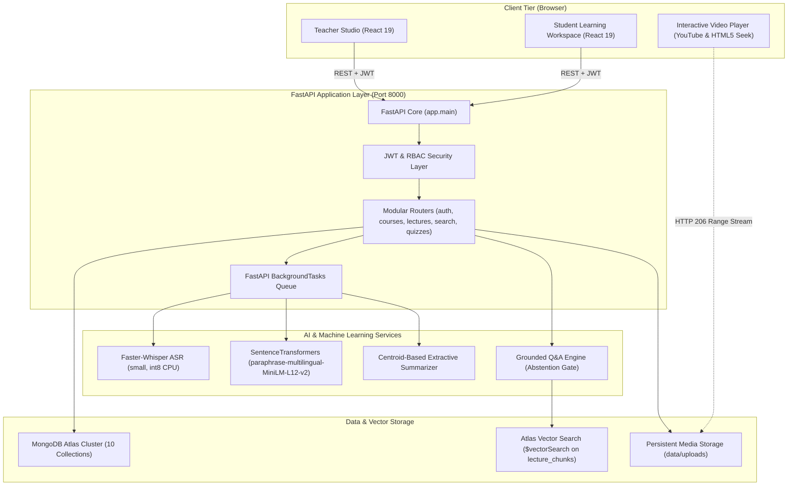

# LectureLens 🎓
### An Intelligent Lecture Transcription, Atlas Vector Search & Personalised Learning Platform

[](https://fastapi.tiangolo.com)
[](https://react.dev)
[](https://www.mongodb.com/products/platform/atlas-vector-search)
[](https://github.com/SYSTRAN/faster-whisper)
[](https://huggingface.co/sentence-transformers/paraphrase-multilingual-MiniLM-L12-v2)
[]()

LectureLens transforms university lectures into an intelligent, searchable, and personalized learning workspace. It combines speech recognition (Faster-Whisper), multilingual topic segmentation, MongoDB Atlas Vector Search, evidence-grounded Q&A (RAG), and interactive assessments with an instructor-in-the-loop review gate.

---

## 📖 Table of Contents

- [The Problem & Objectives](#-the-problem--objectives)
- [Key Features](#-key-features)
- [Technology Stack](#-technology-stack)
- [System Architecture](#-system-architecture)
- [Quick Start Guide](#-quick-start-guide)
- [Pre-Seeded Demo Accounts](#-pre-seeded-demo-accounts)
- [Automated Tests & Evaluation Benchmarks](#-automated-tests--evaluation-benchmarks)
- [Repository Structure](#-repository-structure)
- [Recommended UI Screenshots](#-recommended-ui-screenshots)
- [Documentation Index](#-documentation-index)

---

## 🎯 The Problem & Objectives

University lecture recordings contain dense academic knowledge, yet they remain largely unsearchable. Students spend hours scrubbing through linear videos, struggle with code-mixed bilingual delivery (English and Hindi), and face hallucination risks when querying generic LLMs.

**LectureLens solves this by:**
1. **Transcribing Spoken Lectures**: Leveraging Faster-Whisper with uncertainty indicators (`avg_logprob`) and support for English and Hindi.
2. **Structuring Continuous Speech**: Partitioning transcripts into semantic sections using multilingual sentence transformers.
3. **Enabling Semantic Retrieval**: Storing 384-dimensional dense vectors in MongoDB Atlas to support conceptual search.
4. **Providing Grounded Q&A**: Answering student questions with clickable timestamp citations and an abstention gate for out-of-scope queries.
5. **Responsible Human-in-the-Loop AI**: Enforcing a mandatory teacher review gate for transcripts and quizzes before student publication.
6. **Smart Revision Planning**: Pinpointing weak topics from quiz submissions and generating deep links directly to lecture video timestamps.

---

## ✨ Key Features

| Category | Feature | Status |
| :--- | :--- | :--- |
| **Ingestion** | Audio/Video file upload (`.mp4`, `.mp3`, `.wav`, `.m4a`) & public YouTube links | **Verified** |
| **Transcription** | Faster-Whisper ASR (`small`, `int8` CPU) with confidence indicators (`avg_logprob`) | **Verified** |
| **Segmentation** | Multilingual embedding clustering (`paraphrase-multilingual-MiniLM-L12-v2`) | **Verified** |
| **Summaries** | Centroid-based extractive key-points synthesis with timestamp preservation | **Verified** |
| **Review Studio** | Inline transcript correction, topic title editing, and publication gate | **Verified** |
| **Persistence** | MongoDB Atlas with 10 indexed collections and local fallback (`mongomock-motor`) | **Verified** |
| **Vector Search** | MongoDB Atlas `$vectorSearch` with course and publication filtering | **Verified** |
| **Search Modes** | Semantic Vector Search, Keyword Lexical Search, and Hybrid RRF Search | **Verified** |
| **Grounded Q&A** | RAG question answering with clickable citations and honest abstention cutoff | **Verified** |
| **Assessments** | AI draft quiz generation with mandatory teacher approval and student taking | **Verified** |
| **Analytics** | Class average scores and topic-level error rates for instructors | **Verified** |
| **Revision** | Rule-based personalized recommendations linking to video timestamps | **Verified** |

*See [`docs/features-and-status.md`](docs/features-and-status.md) for the complete Feature Verification Matrix.*

---

## 🛠️ Technology Stack

- **Frontend**: React 19.2, Vite 8.3, React Router v7.13, Lucide Icons.
- **Backend API**: Python 3.9+, FastAPI 0.128, Pydantic v2.13, Uvicorn 0.39.
- **Database & Search**: MongoDB Atlas, PyMongo / Motor 3.7 (Async), MongoDB Atlas Vector Search ($vectorSearch).
- **Speech & AI/ML**: Faster-Whisper 1.2, Sentence-Transformers 5.1 (`paraphrase-multilingual-MiniLM-L12-v2`), PyTorch 2.8, Scikit-learn 1.6, NumPy 2.0.
- **Media Engine**: FFmpeg for audio normalization and HTTP 206 range-aware streaming.
- **Security**: JWT Bearer Tokens (`pyjwt`), password hashing (`bcrypt`), and CORS middleware.
- **Testing & Benchmarks**: Pytest 8.4, Pytest-Asyncio 1.2, HTTPX 0.28.

---

## 🏗️ System Architecture



*Detailed architectural breakdown: [`docs/system-architecture.md`](docs/system-architecture.md)*

---

## 🚀 Quick Start Guide

### Prerequisites
- Python 3.9+ installed (`python3 --version`)
- Node.js 18+ and npm installed (`node --version`)
- FFmpeg installed (`brew install ffmpeg` on macOS, or `apt install ffmpeg` on Linux)

---

### Step 1: Start the Backend (Terminal 1)

```bash
cd backend

# Activate virtual environment
source .venv/bin/activate
# (On Windows: .venv\Scripts\activate)

# Install dependencies (if not already installed)
pip install -r requirements.txt

# Start FastAPI server (notice the spaces before each flag!)
uvicorn app.main:app --reload --host 127.0.0.1 --port 8000
```

- API Base URL: `http://127.0.0.1:8000`
- Interactive Swagger Documentation: `http://127.0.0.1:8000/docs`
- Health Check: `http://127.0.0.1:8000/health`

---

### Step 2: Start the Frontend (Terminal 2)

In a new terminal:

```bash
cd frontend

# Install packages (if not already installed)
npm install

# Start Vite dev server
npm run dev
```

- Web Application: **`http://localhost:5173`**

---

## 👥 Pre-Seeded Demo Accounts

The database automatically seeds these accounts on first startup:

| Role | Email | Password | Allowed Capabilities |
| :--- | :--- | :--- | :--- |
| **Instructor** | `teacher@lecturelens.edu` | `TeacherPass123!` | Create courses, ingest lectures, edit transcripts, approve quizzes, view class analytics |
| **Student** | `student@lecturelens.edu` | `StudentPass123!` | Enrolled in CS401, view approved lectures, vector search, ask questions, take quizzes, revision |
| **Admin** | `admin@lecturelens.edu` | `AdminPass123!` | System-wide administration |

*1-click demo login buttons are provided on the login page.*

---

## 🧪 Automated Tests & Evaluation Benchmarks

### 1. Backend Integration Tests:
```bash
PYTHONPATH=backend backend/.venv/bin/pytest backend/tests/test_api.py -v
```
All **8 integration tests pass** in 2.70 seconds.

### 2. Academic AI Benchmark Suite:
```bash
backend/.venv/bin/python evaluation/run_all_evaluations.py
```
- **ASR Evaluation**: Word Error Rate (WER) and Character Error Rate (CER) on bilingual lecture samples.
- **Segmentation Evaluation**: Boundary Precision, Recall, and F1 score against human-annotated boundaries.
- **Retrieval Evaluation**: Recall@1, Recall@3, and Mean Reciprocal Rank (MRR) comparing Keyword, Atlas Vector Search, and Hybrid RRF.
- Manifest documenting **5.4 hours of lecture recordings**: [`evaluation/data/dataset_manifest.json`](evaluation/data/dataset_manifest.json).

---

## 📁 Repository Structure

```text
LectureLens/
├── backend/
│   ├── app/
│   │   ├── main.py                     # Lifespan, CORS, router aggregation
│   │   ├── config.py                   # Central settings & env configuration
│   │   ├── database.py                 # Motor client, 10 collection indexes, serialization
│   │   ├── dependencies/auth.py        # JWT auth, bcrypt password hashing, seed users
│   │   ├── schemas/                    # Pydantic v2 validation models
│   │   ├── routers/                    # auth, courses, lectures, transcript, topics, search, quizzes, revision, media
│   │   └── services/                   # whisper ASR, segmentation, summarization, vector_search, QA, quiz_gen, revision, youtube
│   ├── tests/test_api.py               # 8 automated integration tests
│   ├── requirements.txt                # Fixed backend Python dependencies
│   └── Dockerfile                      # Production container configuration
├── frontend/
│   ├── src/
│   │   ├── api/client.js               # Central fetch client with Bearer auth
│   │   ├── context/AuthContext.jsx     # Auth state & session rehydration
│   │   ├── components/                 # Navbar, VideoPlayer, ProtectedRoute, StatusBadge, UncertaintyPill
│   │   ├── pages/teacher/              # Studio overview, CourseManager, AddLecture, LectureReview, QuizManager, Analytics
│   │   ├── pages/student/              # Dashboard, LectureViewer, GlobalSearch, QuizExperience, RevisionPlan
│   │   ├── pages/auth/                 # Login & Registration
│   │   └── App.jsx                     # Router & role-based route tree
│   ├── package.json                    # React 19, Vite 8, Lucide Icons, Router v7
│   └── Dockerfile                      # Multi-stage production Nginx container
├── evaluation/                         # Manifest for 5.4h corpus, ASR, segmentation & retrieval benchmarks
├── docs/                               # Comprehensive project documentation suite
├── docker-compose.yml                  # Full-stack Docker deployment
└── README.md                           # Project introduction
```

---

## 📸 Recommended UI Screenshots

For presentations and reports, capture these key screens:
1. **Teacher Studio Overview** (`/teacher`): Showing metric cards (Active Courses, Ingested Lectures, Pending Review) and lecture queue.
2. **Lecture Review Studio** (`/teacher/lectures/:id/review`): Showing video player, timestamped transcript, confidence pills, and inline text correction.
3. **Assessment Approval Gate** (`/teacher/quizzes`): Showing AI-generated draft questions and teacher approval toggle.
4. **Student Lecture Workspace** (`/student/lectures/:id`): Showing video playback synchronized with clickable transcript timestamps.
5. **Atlas Semantic Search & Q&A** (`/student/search`): Demonstrating semantic search and grounded answers with clickable timestamp citations.
6. **Personalized Smart Revision Plan** (`/student/revision`): Showing weak topic diagnoses and direct video jump buttons.

---

## 📚 Complete Documentation Index

- [Project Overview & Requirements](docs/project-overview.md)
- [Feature Implementation & Verification Matrix](docs/features-and-status.md)
- [System Architecture & Sequence Flows](docs/system-architecture.md)
- [Frontend Architecture & Guide](docs/frontend-guide.md)
- [Backend Architecture & Guide](docs/backend-guide.md)
- [MongoDB Database Architecture & Schema Reference](docs/database-design.md)
- [Complete API Reference](docs/api-reference.md)
- [AI & Machine Learning Pipeline](docs/ai-pipeline.md)
- [Authentication & Security Architecture](docs/authentication-and-security.md)
- [Local Setup & Development Guide](docs/local-setup.md)
- [Production Deployment Guide](docs/deployment-guide.md)
- [Testing & Academic Evaluation Suite](docs/testing-and-evaluation.md)
- [Troubleshooting & Diagnostic Guide](docs/troubleshooting.md)
- [Teacher & Instructor User Guide](docs/user-guide-teacher.md)
- [Student Learning Hub User Guide](docs/user-guide-student.md)
- [Academic Viva Examination Guide](docs/viva-preparation.md)
- [Limitations & Future Roadmap](docs/limitations-and-future-work.md)
- [MongoDB Atlas Vector Search Guide](docs/mongo_atlas_setup.md)
