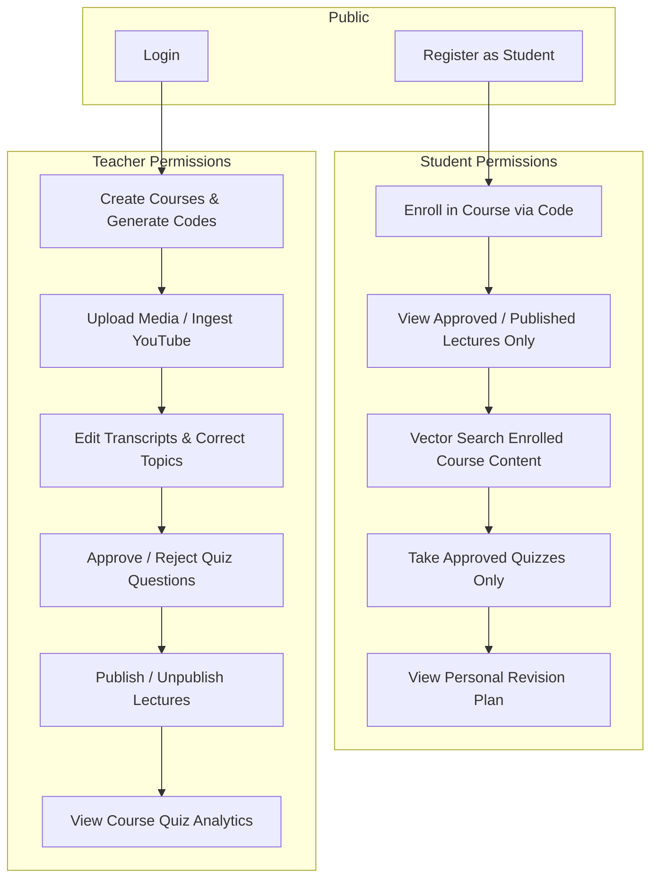

# Authentication, Authorization & Security Architecture

## 1. Overview & Threat Model

LectureLens handles institutional lecture media, student assessment scores, and unpublished teaching drafts. Security and data integrity are enforced primarily at the backend API layer.

---

## 2. Authentication & Credential Security

### Password Hashing (`bcrypt`)
User passwords are never stored in plaintext. In [`backend/app/dependencies/auth.py`](file:///Users/ananadmauya/Projects/lecturelens/backend/app/dependencies/auth.py):
- Passwords are salted and hashed using `bcrypt.hashpw(password, bcrypt.gensalt())`.
- Passwords are verified using constant-time comparison `bcrypt.checkpw(plain, hashed)`.

### JWT Access Tokens (`pyjwt`)
- Tokens are signed using the `HS256` symmetric algorithm with `settings.SECRET_KEY`.
- Payload contains user ID (`sub`), role (`role`), and UTC expiration timestamp (`exp`).
- Default token lifetime is 24 hours (1440 minutes), configurable via `ACCESS_TOKEN_EXPIRE_MINUTES`.
- Expired or tampered tokens are rejected with HTTP 401 Unauthorized.

---

## 3. Role-Based Access Control (RBAC)

The system defines three roles: `student`, `teacher`, and `admin`.



### Prevention of Privilege Escalation
In [`backend/app/routers/auth.py`](file:///Users/ananadmauya/Projects/lecturelens/backend/app/routers/auth.py), public user registration defaults strictly to `role: "student"`. If a user submits `role: "teacher"` or `role: "admin"`, the server enforces:
```python
if role in [UserRole.TEACHER, UserRole.ADMIN]:
    if payload.teacher_invite_code != TEACHER_INVITE_SECRET:
        raise HTTPException(
            status_code=status.HTTP_403_FORBIDDEN,
            detail="Invalid teacher authorization invite code."
        )
```

---

## 4. Multi-Tenant Course & Content Isolation

1. **Course Isolation**: Students can query lectures and chunks only within courses they are explicitly enrolled in (`student_ids` contains `user_id`).
2. **Teacher Ownership**: Teachers can modify or delete only lectures for courses they instruct (`teacher_id == current_user.id`), unless holding the `admin` role.
3. **Assessment Integrity**: The endpoint `GET /api/lectures/{id}/quizzes` dynamically checks the requester's role:
   - For students: filters `{"is_approved": True}` and strips out `correct_answer` and `explanation` so answer keys are not inspectable in browser dev tools before submission.
   - For teachers: returns all drafts with complete pedagogical explanations.

---

## 5. Audit Logging & Non-Repudiation

Meaningful educational actions are logged in the `audit_logs` collection:
- `transcript_edit`: records user ID, timestamp, segment index, previous text, and corrected text.
- `topic_edit`: records topic title and boundary adjustments.
- `content_publish` / `content_unpublish`: records visibility state transitions.
- `quiz_approval` / `quiz_rejection`: records teacher verification of assessment questions.

---

## 6. Media Validation & Input Sanitization

1. **File Type Verification**: Incoming file extensions are checked against an explicit whitelist (`.mp4`, `.mp3`, `.wav`, `.m4a`, `.mov`, `.webm`, `.ogg`, `.flac`).
2. **Directory Traversal Mitigation**: File paths are sanitized using `pathlib.Path(filename).name` before touching disk storage.
3. **Institutional Consent**: Lecture ingestion requires explicit confirmation of student and speaker recording consent, recorded in lecture metadata.
4. **CORS Security**: Cross-Origin Resource Sharing is restricted to explicit origins specified in `ALLOWED_ORIGINS` (defaulting to `http://localhost:5173`).

---

## 7. Known Security Limitations & Recommendations

- **Local Storage of JWT Tokens**: Tokens are stored in browser `localStorage`. In high-security university enterprise environments, storing tokens in `httpOnly` secure cookies is recommended to mitigate XSS risks.
- **Media File Access**: Uploaded media streams are currently served from local disk. In cloud production, serving via signed, expiring pre-signed URLs (e.g., AWS S3 CloudFront) is recommended.

