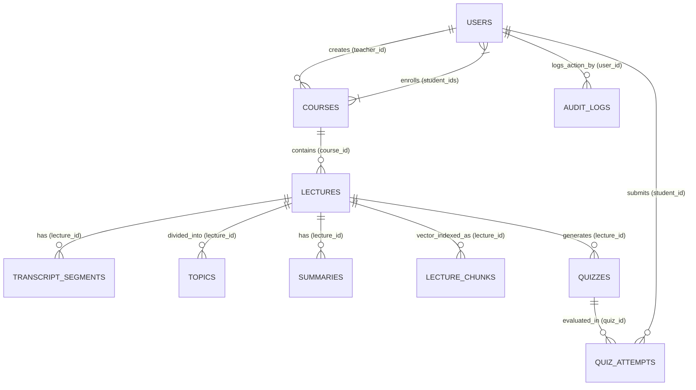

# MongoDB Database Architecture & Atlas Vector Search Design

## 1. Overview & Connection Architecture

LectureLens uses **MongoDB Atlas** as its primary operational and vector database. The database connection is managed asynchronously using `motor.motor_asyncio` through [`backend/app/database.py`](file:///Users/ananadmauya/Projects/lecturelens/backend/app/database.py).

### Connection Strategy
1. **Production / Live Atlas Mode**: Reads `MONGODB_URI` from the environment. Uses connection pooling (`uuidRepresentation="standard"` and 5000ms server selection timeout).
2. **Offline Development Fallback**: If `MONGODB_URI` is unset or unreachable during offline local development, the application initializes an in-memory asynchronous mock (`mongomock-motor`), allowing the entire stack and test suite to run without external network dependencies.



---

## 2. Collection Schemas & Indexing Strategy

### 1. `users`
Stores user identity, credentials, role, and status.

```json
{
  "_id": "ObjectId('671aa...01')",
  "name": "Prof. Rajesh Sharma",
  "email": "teacher@lecturelens.edu",
  "password_hash": "$2b$12$K8...",
  "role": "teacher",
  "status": "active",
  "created_at": "2026-10-24T14:30:00Z",
  "updated_at": "2026-10-24T14:30:00Z"
}
```
- **Indexes**: `email` (Unique), `role`.

---

### 2. `courses`
Stores academic courses, instructor ownership, and enrolled students.

```json
{
  "_id": "ObjectId('671aa...02')",
  "title": "CS 401: Artificial Intelligence & Machine Learning",
  "description": "Fundamental concepts of modern AI, multilingual embeddings, and vector search.",
  "code": "CS401",
  "teacher_id": "671aa...01",
  "student_ids": ["671aa...03"],
  "created_at": "2026-10-24T14:30:00Z",
  "updated_at": "2026-10-24T14:30:00Z"
}
```
- **Indexes**: `code` (Unique), `teacher_id`, `student_ids`.

---

### 3. `lectures`
Stores lecture metadata, media paths, processing states, and publication flags.

```json
{
  "_id": "ObjectId('671aa...04')",
  "title": "Lecture 4: Self-Attention & Transformers",
  "description": "Architecture details of scaled dot-product attention.",
  "course_id": "671aa...02",
  "teacher_id": "671aa...01",
  "source_type": "youtube",
  "youtube_url": "https://www.youtube.com/watch?v=kCc8FmEb1nY",
  "youtube_video_id": "kCc8FmEb1nY",
  "media_url": "https://www.youtube-nocookie.com/embed/kCc8FmEb1nY?enablejsapi=1&rel=0",
  "status": "published",
  "is_published": true,
  "language": "en",
  "language_probability": 0.98,
  "duration": 3720.0,
  "segments": [...],
  "topics": [...],
  "summaries": [...],
  "created_at": "2026-10-24T14:35:00Z",
  "updated_at": "2026-10-24T14:40:00Z"
}
```
- **Indexes**: `course_id`, `teacher_id`, `status`, `is_published`.

---

### 4. `transcript_segments`
Stores granular timestamped speech chunks with model uncertainty metrics.

```json
{
  "_id": "ObjectId('671aa...05')",
  "lecture_id": "671aa...04",
  "segment_index": 0,
  "start": 0.0,
  "end": 5.2,
  "text": "Welcome to neural attention mechanisms.",
  "avg_logprob": -0.12,
  "no_speech_prob": 0.01,
  "compression_ratio": 1.2,
  "is_edited": false,
  "original_text": null
}
```
- **Compound Index**: `[("lecture_id", 1), ("segment_index", 1)]`.

---

### 5. `topics`
Stores semantic sections derived from embedding boundary clustering.

```json
{
  "_id": "ObjectId('671aa...06')",
  "lecture_id": "671aa...04",
  "topic_id": 1,
  "title": "Scaled Dot-Product Attention Overview",
  "start": 0.0,
  "end": 480.0,
  "segments": [...],
  "is_edited": false
}
```
- **Compound Index**: `[("lecture_id", 1), ("topic_id", 1)]`.

---

### 6. `summaries`
Stores centroid-based extractive summaries for each topic section.

```json
{
  "_id": "ObjectId('671aa...07')",
  "lecture_id": "671aa...04",
  "topic_id": 1,
  "summary_type": "extractive",
  "summary_text": "Scaled dot-product attention computes query-key similarity matrices...",
  "key_points": [
    "Input vectors are projected into queries, keys, and values.",
    "Softmax normalizes dot products across the sequence."
  ],
  "is_approved": true
}
```
- **Index**: `lecture_id`.

---

### 7. `lecture_chunks` (Atlas Vector Search Storage)
Stores context windows with 384-dimensional dense multilingual embeddings for semantic retrieval.

```json
{
  "_id": "ObjectId('671aa...08')",
  "lecture_id": "671aa...04",
  "course_id": "671aa...02",
  "topic_id": 1,
  "topic_title": "Scaled Dot-Product Attention Overview",
  "chunk_index": 0,
  "start": 0.0,
  "end": 14.5,
  "text": "In transformer self-attention, input vectors are projected into queries, keys, and values using learned weight matrices.",
  "embedding_model": "paraphrase-multilingual-MiniLM-L12-v2",
  "embedding_dim": 384,
  "embedding": [0.0412, -0.0125, 0.0891, ...],
  "is_published": true
}
```
- **Indexes**: `[("lecture_id", 1), ("chunk_index", 1)]`, `course_id`, `is_published`.

---

### 8. `quizzes`
Stores assessment questions generated from lecture topics.

```json
{
  "_id": "ObjectId('671aa...09')",
  "lecture_id": "671aa...04",
  "topic_id": 1,
  "question_type": "mcq",
  "question": "What is the primary role of queries and keys in self-attention?",
  "options": [
    "Computing alignment weights via dot products",
    "Compressing audio frequencies",
    "Replacing backpropagation"
  ],
  "correct_answer": "Computing alignment weights via dot products",
  "explanation": "Refer to the lecture discussion around 12.0s.",
  "difficulty": "medium",
  "is_approved": true
}
```
- **Indexes**: `lecture_id`, `is_approved`.

---

### 9. `quiz_attempts`
Records student submissions, scores, and topic-level weakness flags.

```json
{
  "_id": "ObjectId('671aa...10')",
  "student_id": "671aa...03",
  "student_name": "Priya Verma",
  "lecture_id": "671aa...04",
  "score": 100.0,
  "percentage": 100.0,
  "total_questions": 1,
  "correct_count": 1,
  "results": [...],
  "weak_topics": [],
  "created_at": "2026-10-24T15:00:00Z"
}
```
- **Indexes**: `student_id`, `lecture_id`.

---

### 10. `audit_logs`
Maintains an immutable audit trail of teacher actions (transcript corrections, topic updates, publishing).

```json
{
  "_id": "ObjectId('671aa...11')",
  "user_id": "671aa...01",
  "action": "transcript_edit",
  "entity_type": "transcript_segment",
  "entity_id": "671aa...04_0",
  "diff": {
    "previous_text": "Welcome to neural attention.",
    "new_text": "Welcome to deep self-attention mechanisms."
  },
  "timestamp": "2026-10-24T14:45:00Z"
}
```
- **Indexes**: `[("entity_type", 1), ("entity_id", 1)]`, `timestamp`.

---

## 3. MongoDB Atlas Vector Search Implementation

### Chunking Strategy
Lecture transcripts are grouped into overlapping windows of 2 to 3 consecutive segments (~80–180 words) within topic boundaries. This window size provides sufficient context for semantic embeddings while maintaining high timestamp precision.

### Atlas Vector Index Definition (`vector_index`)
Created in MongoDB Atlas Search with `numDimensions: 384` and `similarity: cosine`:

```json
{
  "fields": [
    {
      "type": "vector",
      "path": "embedding",
      "numDimensions": 384,
      "similarity": "cosine"
    },
    {
      "type": "filter",
      "path": "course_id"
    },
    {
      "type": "filter",
      "path": "lecture_id"
    },
    {
      "type": "filter",
      "path": "is_published"
    }
  ]
}
```

### `$vectorSearch` Aggregation Query Structure
Executed by [`backend/app/services/vector_search.py`](file:///Users/ananadmauya/Projects/lecturelens/backend/app/services/vector_search.py):

```python
pipeline = [
    {
        "$vectorSearch": {
            "index": "vector_index",
            "path": "embedding",
            "queryVector": query_384d_embedding,
            "numCandidates": 50,
            "limit": 5,
            "filter": {
                "course_id": target_course_id,
                "is_published": True
            }
        }
    },
    {
        "$project": {
            "_id": 1,
            "lecture_id": 1,
            "course_id": 1,
            "topic_id": 1,
            "topic_title": 1,
            "start": 1,
            "end": 1,
            "text": 1,
            "score": {"$meta": "vectorSearchScore"}
        }
    }
]
```

