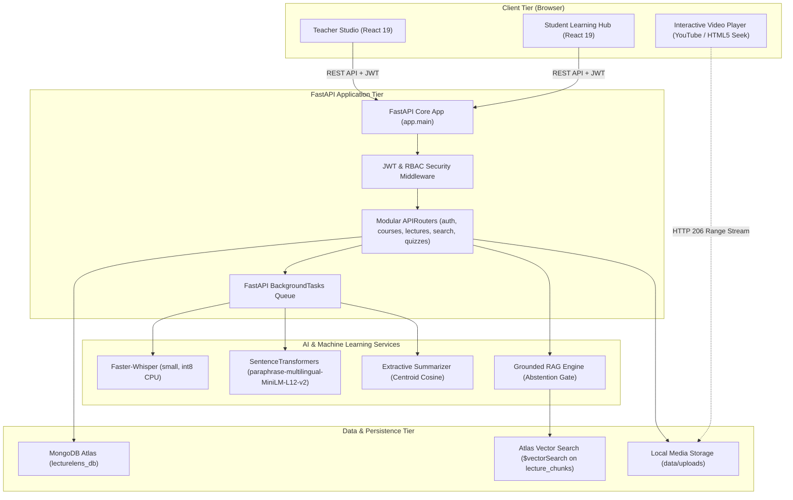
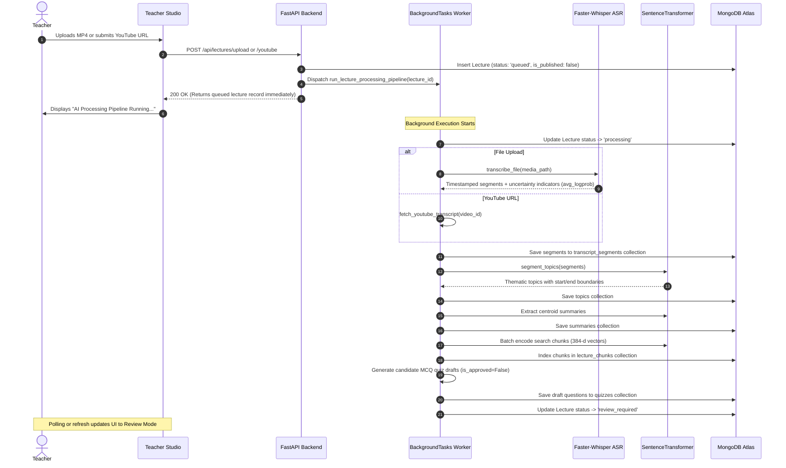
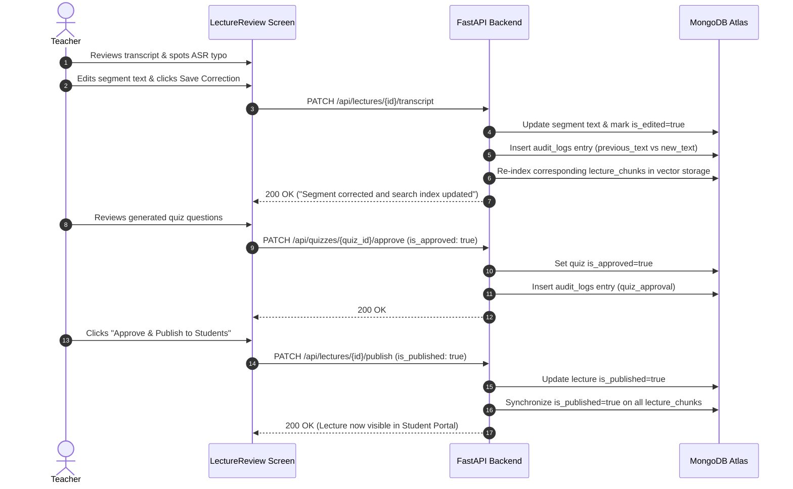
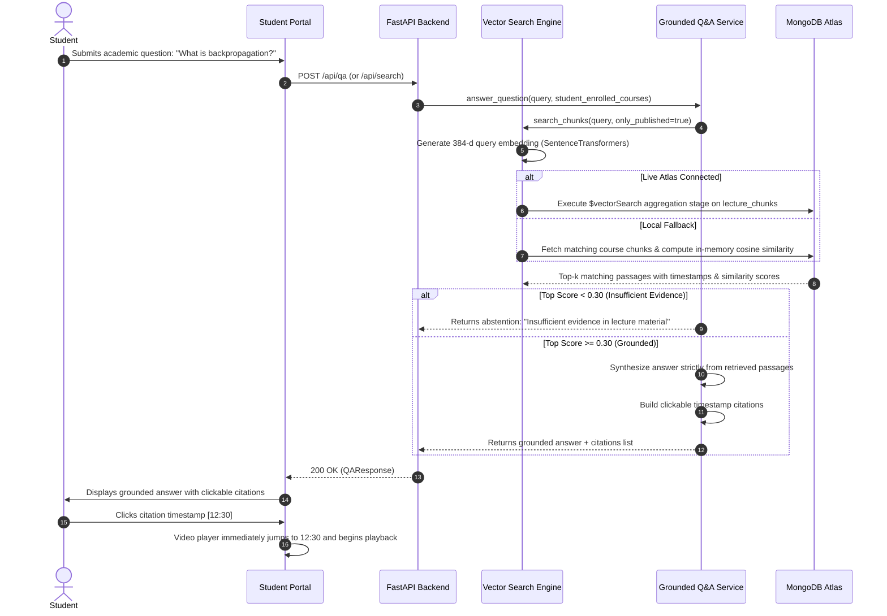

# System Architecture & Design

## 1. High-Level Architecture Overview

LectureLens adopts a modular, decoupled architecture consisting of a **React 19 Frontend**, a **FastAPI Asynchronous Backend**, an **AI/ML Processing Engine**, and **MongoDB Atlas** for document storage and Vector Search.

---

## 2. Component Responsibilities & Separation of Concerns

### 1. Frontend Tier (`frontend/src/`)
- **Single Page Application (SPA)**: Built with React 19 and Vite 8 for fast build and reload times.
- **Client-Side Routing**: Managed via `react-router-dom` v7 with role-guarded route trees (`/teacher/*` vs `/student/*`).
- **Central API Client**: [`frontend/src/api/client.js`](file:///Users/ananadmauya/Projects/lecturelens/frontend/src/api/client.js) centralizes all REST interactions, handles Bearer token injection, and intercepts 401 session expiration events.
- **Interactive Player**: Uses a unified imperative ref API (`seekTo(seconds)`) supporting both YouTube iframes (via postMessage) and HTML5 `<video>` / `<audio>` elements.

### 2. Backend Tier (`backend/app/`)
- **FastAPI Framework**: High-performance asynchronous Python framework using ASGI (`uvicorn`).
- **Strict Lifespan Management**: Initializes database connections, runs index verification, and seeds initial accounts on startup; closes resources cleanly on shutdown.
- **Pydantic v2 Validation**: Validates all incoming payloads (`UserRegister`, `LectureCreate`, `SearchRequest`, `QuizAttemptSubmit`) and serializes responses.
- **Decoupled Service Layer**: Business logic and ML inference are isolated into dedicated modules under `app.services.*`, leaving routers lightweight and focused on HTTP status codes and permissions.

### 3. Database Tier (`MongoDB Atlas`)
- **Document Model**: Leverages MongoDB's flexible BSON document model for complex hierarchical structures like lecture transcripts and quiz breakdowns.
- **Atlas Vector Search**: Executes `$vectorSearch` aggregations directly against the database cluster, eliminating the operational overhead of a separate vector database (e.g. Pinecone or Milvus).
- **Asynchronous Driver**: Utilizes `motor.motor_asyncio` to prevent I/O blocking during database calls.

---

## 3. Core Workflows & Sequence Diagrams

### Workflow A: Lecture Ingestion & Processing Pipeline

---

### Workflow B: Teacher Review & Publication Gate

---

### Workflow C: Student Semantic Search & Grounded Q&A (RAG)

---

## 4. Key Architectural Trade-Offs

| Decision | Selected Approach | Alternative Considered | Rationale |
| :--- | :--- | :--- | :--- |
| **Database** | MongoDB Atlas with Vector Search | PostgreSQL (pgvector) or SQLite + ChromaDB | MongoDB Atlas combines document metadata, transcript arrays, and vector search in a single managed cluster, avoiding dual-database sync issues. |
| **API Framework** | Python FastAPI | Node.js / Express | Native Python ecosystem is required for direct in-process execution of Faster-Whisper, PyTorch, and Sentence Transformers without multi-process IPC. |
| **ASR Engine** | Faster-Whisper (CTranslate2) | OpenAI Cloud Whisper API | Self-hosted Faster-Whisper on CPU runs locally without API costs, respects student data privacy, and supports offline execution. |
| **Embedding Model** | `paraphrase-multilingual-MiniLM-L12-v2` (384-d) | Monolingual English embeddings (`all-MiniLM-L6-v2`) | Lectures in Indian universities frequently alternate between Hindi and English; multilingual embeddings preserve semantic proximity across languages. |
| **RAG Abstention Gate** | Strict similarity cutoff ($\text{similarity} < 0.30$) | Unbounded generative completion | Prevents generative hallucination on questions outside course scope (e.g. general trivia or cooking recipes). |

